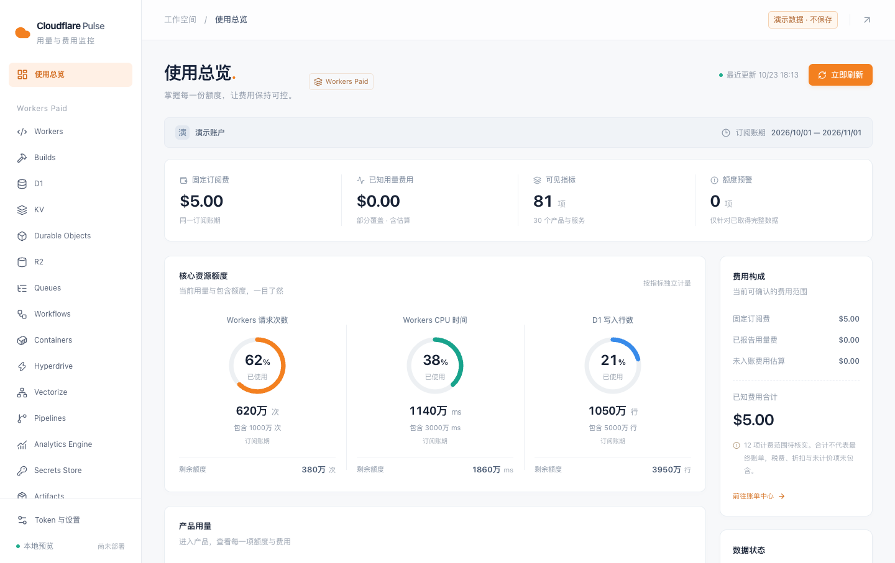
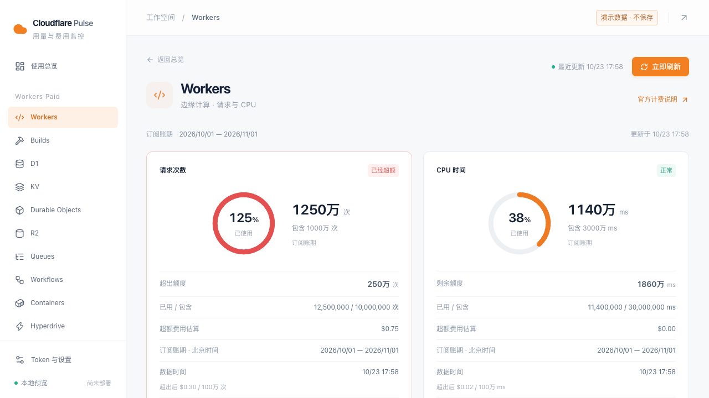
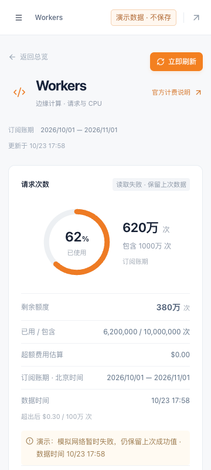
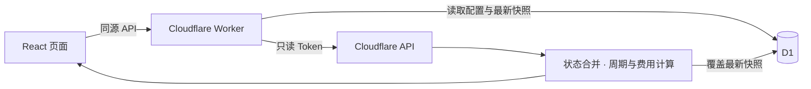

<div align="center">


# Cloudflare Pulse

**看清用量、掌握额度，让 Cloudflare 费用心中有数。**

面向个人自托管的单账户监控面板，聚合当前账期用量、剩余额度与已知费用。

<p>
  <a href="https://react.dev/"></a>
  <a href="https://www.typescriptlang.org/"></a>
  <a href="https://developers.cloudflare.com/workers/"></a>
  <a href="https://developers.cloudflare.com/d1/"></a>
  <a href="https://nodejs.org/"></a>
</p>

[界面预览](#界面预览) · [快速开始](#快速开始) · [产品覆盖](#产品覆盖) · [部署说明](docs/deployment.md) · [文档导航](#文档导航)

</div>



> 所有公开截图均来自独立演示模式，数字为合成样例。当前版本已完成本地验证，可按部署说明发布到自己的 Workers 实例。

## 能做什么

| 能力             | 体验                                                                       |
| ---------------- | -------------------------------------------------------------------------- |
| **用量一眼可见** | 动态额度环、精确数值、剩余量与阈值状态；超额时继续显示实际比例和超出量。   |
| **费用有据可查** | 固定订阅费、已报告用量费、未入账费用估算分别展示，标明计价覆盖范围。       |
| **产品独立查看** | 30 个产品入口、81 项基础指标；订阅可在运行时发现额外计量。                 |
| **失败保留数据** | 临时失败保留上次成功值与时间；暂无记录、未开通、失败和部分覆盖分别呈现。   |
| **按需更新**     | 打开或重载时读取一次，也可手动刷新；内部切页复用快照，并发刷新合并。       |
| **凭据加密保存** | 账户级与用户级只读 Token 独立验证、替换和清除，AES-GCM 密文保存到 D1。     |
| **手机也能用**   | 响应式布局、产品导航抽屉、中文界面、USD 金额与北京时间，支持减少动态效果。 |

只保存最新状态，不采集历史序列，不运行定时任务，也不做费用预测。

## 界面预览

### 超额，也看得清楚



<details>
<summary><strong>查看手机端：读取失败时保留上次成功值</strong></summary>

<br />


</details>

## 快速开始

需要 **Node.js 22.12+** 与 npm。安装版本由 `package-lock.json` 固定。

```sh
git clone https://github.com/nympheon/cloudflare-dashboard.git
cd cloudflare-dashboard
npm ci
npm run setup:local
npm run dev
```

打开 **[http://127.0.0.1:5173/](http://127.0.0.1:5173/)**。

`setup:local` 会生成本机专用的加密主密钥，并应用本地 D1 迁移；已有密钥会保留。密钥在 `.dev.vars`，数据库和运行文件在 `.wrangler/`，均已被 Git 忽略。本地启动不需要先部署 Worker 或创建远程 D1。

### 先看演示

启动开发服务器后，无需填写 Token 即可预览：

| 场景     | 本地地址                                                            |
| -------- | ------------------------------------------------------------------- |
| 使用总览 | [正常用量](http://127.0.0.1:5173/?demo=normal)                      |
| 接近额度 | [85% 预警](http://127.0.0.1:5173/products/workers?demo=warning)     |
| 超出额度 | [125% 超额](http://127.0.0.1:5173/products/workers?demo=overage)    |
| 临时失败 | [保留最后成功值](http://127.0.0.1:5173/products/workers?demo=error) |

演示模式有醒目标识，不访问真实账户、不保存 Token；演示数据不进入生产客户端。

### 连接自己的账户

进入 **Token 与设置**，分别填写账户级、用户级只读 API Token，验证后保存。两个 Token 必须对应同一个账户；配置与排查方式见 [凭据配置](docs/configuration.md)。

完整 Token 仅提交给同源服务端，供服务端验证和读取 Cloudflare API；不会回显或写入浏览器存储。设置页仅显示末四位。不要删除正在使用的 `.dev.vars` 主密钥，否则需要重新保存 Token。

> [!IMPORTANT]
> 当前没有内置登录。远程部署前，请用 Cloudflare Access 或等效机制保护整个站点及 `/api/*`，核对所有访问入口后再填入真实凭据。详见 [部署说明](docs/deployment.md)。

## 产品覆盖

| 范围           | 产品与服务                                                                              |
| -------------- | --------------------------------------------------------------------------------------- |
| 计算与存储     | Workers、Builds、D1、KV、Durable Objects、R2、Queues、Workflows、Containers、Hyperdrive |
| 数据与开发服务 | Vectorize、Pipelines、Analytics Engine、Secrets Store、Artifacts、Workers for Platforms |
| AI 与媒体      | Workers AI、AI Gateway、AI Search、Browser Rendering、Images、Stream、Realtime、TURN    |
| 网络与订阅     | Argo、Cache Reserve、Load Balancing、Spectrum、Zero Trust、域名与订阅                   |

产品入口不代表已开通，也不代表每项均能完整读取或计价。API 权限、统计保留期与账单入账延迟都会影响可见范围；每项指标保留自己的来源、单位和周期。

完整列表见 [产品与计量目录](docs/coverage/cloudflare-products.md)，适配边界见 [来源核查](docs/coverage/source-verification.md)。

## 如何理解费用

- **已报告金额**来自账单来源；**未入账估算**只计算尚未入账的增量，避免重复汇总同一计量。
- **订阅账期、自然月、每日额度和当前容量**分别呈现；年度订阅或每日 AI 估算不会混入同一个账期合计。
- **部分覆盖、缺少权限和暂无记录**都不会被当作零费用；无法可靠换算的项目保持未计价状态。
- **已知费用合计不是最终账单**，不包含未计价项、税费与折扣。请以 Cloudflare 正式账单为准。

## 实现方式



前端使用 React、TypeScript、Vite、Tailwind CSS 和 shadcn/ui；Worker 提供 API，D1 保存加密配置和最新成功状态。金额使用 Decimal，接口数字无损读取；刷新使用有界并发、租约和配置版本隔离。

<details>
<summary><strong>项目结构</strong></summary>

```text
src/                 页面、交互、额度图表与开发演示
worker/              API、来源适配、费用计算、凭据加密与存储
shared/              产品目录与前后端数据契约
migrations/          D1 数据库迁移
tests/               单元测试与 Workers / D1 集成测试
scripts/             本地初始化、运行与性能测量
docs/                部署、覆盖范围、设计与验证说明
```

</details>

## 开发与验证

```sh
npm run typecheck
npm run lint
npm run test:unit
npm run test:worker
npm run build
npm run deploy:dry-run
```

`deploy:dry-run` 只检查部署产物，不发布远程资源。本地性能测量使用 `npm run measure:local`，需要先连接自己的账户，结果写入被忽略的 `.private/acceptance/`。

## 文档导航

| 文档                                                   | 内容                                  |
| ------------------------------------------------------ | ------------------------------------- |
| [凭据配置](docs/configuration.md)                      | 双 Token、权限边界、密钥与常见问题    |
| [部署说明](docs/deployment.md)                         | 访问保护、生产 D1、Secret、发布与回滚 |
| [公开仓库说明](docs/public-repository.md)              | 脱敏范围、忽略规则与提交检查          |
| [产品与计量目录](docs/coverage/cloudflare-products.md) | 指标、单位、周期和默认额度            |
| [来源核查](docs/coverage/source-verification.md)       | API 来源、延迟、单位与计价限制        |
| [本地验证](docs/acceptance/local-page-review.md)       | 自动检查、页面场景与演示截图          |
| [性能验证方法](docs/acceptance/local-performance.md)   | D1 行数、并发刷新与测量边界           |

---

<div align="center">

个人自托管项目，与 Cloudflare 官方无隶属关系。产品名称与商标归各自所有者。

</div>
